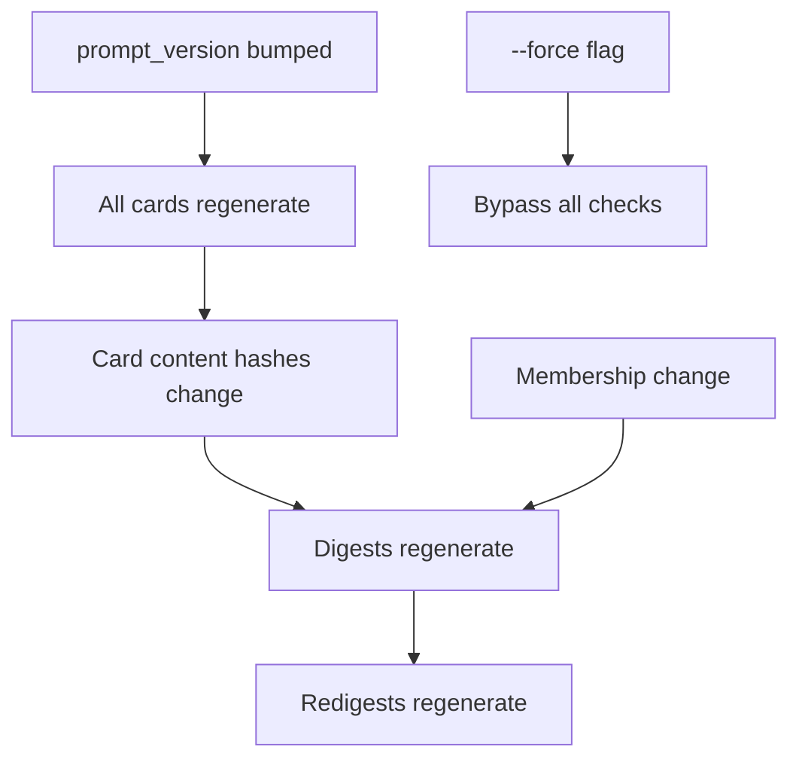

# Caching & Incremental Runs

`zsum` caches aggressively so you don't re-process papers on subsequent runs. This page explains how caching works and how to control it.

## How Caching Works

### Cards

Stored as `cache/cards/{citekey}.json`. On subsequent runs, papers with existing cached cards are skipped — only new or uncached papers are sent to the LLM.

Each card file includes a `_meta` block recording:

- `model` — the LLM model that generated it
- `prompt_version` — the config value at generation time
- `generated_at` — ISO 8601 timestamp

### Digests

Stored as `cache/digests/{collection_key}.md` with companion hash files (`{collection_key}_hashes.json`). Digests are invalidated and regenerated when:

- **Membership changes** — papers added to or removed from a collection
- **Card content changes** — any member paper's card content changes (detected via SHA-256 hash comparison)

### Redigests

Stored as `cache/redigests/{collection_key}.md` with JSON sidecar files that record the source first-pass digest hash and provider metadata. Redigests regenerate when the underlying first-pass digest changes.

### Membership Snapshots

Stored in `cache/membership.json`. Maps each collection key to a sorted list of citekeys. Used to detect when papers are added to or removed from a collection between runs.

## Invalidation Chain

The cache uses a layered invalidation chain. Changes cascade downward:



1. **`prompt_version` change** — Cards are only loaded from cache when their `_meta.prompt_version` matches the current config value. A mismatch triggers regeneration.

2. **Card content hash** — `card_content_hash()` computes a SHA-256 digest of all card fields (excluding `_meta`), using `json.dumps(data, sort_keys=True)` for a stable canonical form.

3. **Card hash change** — `any_card_content_changed()` compares current hashes against the saved `{col_key}_hashes.json`. If any differ, the digest is stale.

4. **Membership change** — The digests stage compares the current sorted citekey list against the saved membership snapshot. Any addition or removal triggers regeneration.

5. **`--force`** — Bypasses all checks for the specified stage.

## Forcing Regeneration

Three approaches:

### 1. `--force` Flag

```bash
zsum cards --force    # regenerate all cards
zsum digests --force  # regenerate all digests
zsum redigest --force # regenerate all redigests
```

!!! warning "cards --force vs digests --force"

    | | `cards --force` | `digests --force` |
    |---|---|---|
    | What is deleted | Nothing; items are simply not skipped | All `*.md` files in `cache/digests/` |
    | What is regenerated | All cards (re-extract + re-LLM) | All digests (from **existing** cards) |

    `digests --force` reuses cached cards — it only re-runs the digest synthesis. Use it when you want fresh collection summaries without re-spending card budget.

### 2. Bump `prompt_version`

Change `prompt_version` in `config.yaml` to invalidate all cached cards:

```yaml
prompt_version: 2  # was 1
```

This cascades: cards regenerate, which changes content hashes, which invalidates digests, which invalidates redigests.

### 3. Clear Cache

```bash
zsum clear-cache --all      # nuclear option: clear everything
zsum clear-cache --cards    # just cards
zsum clear-cache --digests  # just digests
```

## Cost Awareness

LLM calls happen only in the **cards**, **digests**, and **redigest** stages. These commands never call the LLM:

| Command | Cost |
|---|---|
| `skeleton` | Free |
| `index` | Free |
| `extract` | Free |
| `publish` | Free |
| `stats` | Free |
| `reviews` | Free |
| `citations` | Free (network only) |

On incremental runs, only new/uncached papers incur LLM costs. Use `zsum stats` to check how many papers are pending before running `cards`.

## Retry Behavior

When an LLM call fails (network timeout, rate limit, server error), `zsum` automatically retries up to 3 times with exponential backoff. Each retry is logged as a WARNING. Use `-v` (verbose mode) to see per-paper failures and retry attempts.
