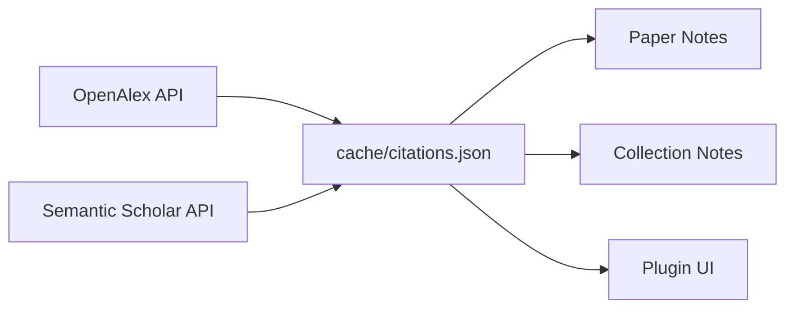

# Citation Counts

`zsum citations` fetches citation counts from academic databases and integrates them into your vault.

## Overview

Citation data flows through the pipeline like this:



- **Primary provider**: [OpenAlex](https://openalex.org/) — no authentication required
- **Fallback provider**: [Semantic Scholar](https://www.semanticscholar.org/) — optional API key for higher rate limits
- **Lookup strategy**: DOI-first, with conservative title+year+author fallback

## Usage

```bash
zsum citations                            # fetch missing/stale counts
zsum citations --refresh                  # force re-fetch everything
zsum citations --top 10                   # show top-N most-cited
zsum citations --collection "Batteries"   # restrict to one collection
```

### Example Output

```
Top 10 most-cited papers:
   3847  @miehe2010PhaseField (2010) A phase field model for rate-independent crack propagation
   2156  @borden2012PhaseFiel (2012) A phase-field description of dynamic brittle fracture
   1823  @ambati2015ReviewPha (2015) A review on phase-field models of brittle fracture
    ...
```

## Configuration

```yaml
citations:
  enabled: true                  # set to false to skip all network calls
  provider: openalex             # primary lookup
  fallback: semantic_scholar     # fallback if primary misses ("" to disable)
  email: you@example.com         # recommended for OpenAlex polite pool
  api_key: ""                    # Semantic Scholar API key (optional)
  rate_limit_delay: 0.1          # seconds between requests
  max_age_days: 30               # refetch cached records older than this
  top_n: 10                      # default N for --top
  timeout_seconds: 10.0          # HTTP timeout per request
```

!!! tip "OpenAlex polite pool"
    Setting your email gives you access to OpenAlex's polite pool with higher rate limits. No authentication required — just the email header.

## Where Counts Appear

Once fetched, citation counts integrate into several places:

### Paper Notes

Added to YAML frontmatter:

```yaml
---
citation_count: 3847
citation_source: openalex
---
```

### Collection Notes

A `## Most Cited Papers` section is added to each collection note, showing the top-N most-cited papers in that collection.

### Obsidian Plugin

The plugin's paper list gains a **Citations** column and a sort toggle to order papers by citation count.

## Cache Behavior

- Counts are cached in `cache/citations.json`
- Records older than `max_age_days` are re-fetched automatically
- Use `--refresh` to force re-fetch everything
- `clear-cache` does **not** clear citations — delete `cache/citations.json` manually for a full reset

## Re-Publishing with Citations

After fetching citations, re-run publish so the counts appear in your vault:

```bash
zsum citations
zsum publish    # re-publish with citation data
```

## Network Safety

The citation fetcher is designed to be fail-safe:

- All network errors are caught — offline runs silently use cached values
- `citations.enabled: false` disables all network calls
- The pipeline never fails due to a citation lookup issue
