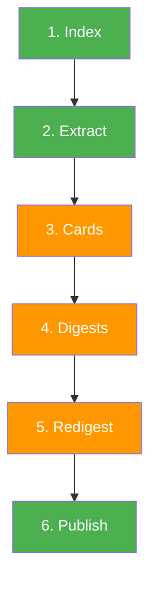
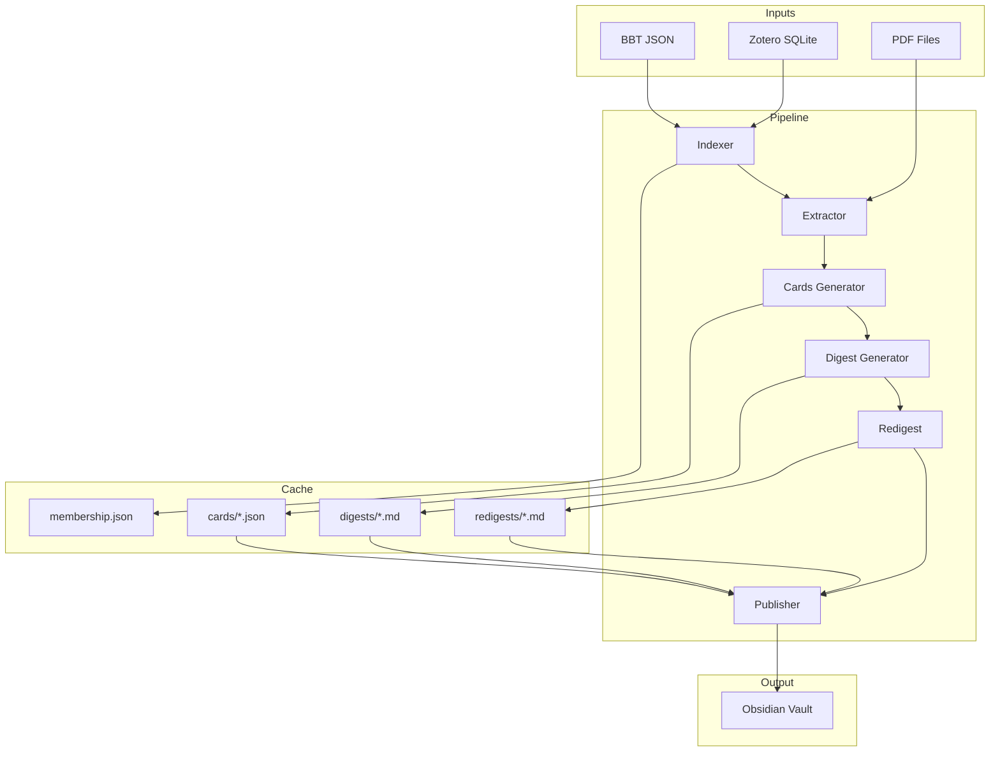

# Pipeline Overview

`zsum` processes your Zotero library through a linear 6-stage pipeline. Each stage has a clear contract: defined inputs, outputs, and side effects.

## Stages at a Glance



!!! note "Cost legend"
    - **Green** stages are free — no LLM calls
    - **Orange** stages call the LLM and cost tokens

| # | Stage | Command | LLM | Description |
|---|---|---|---|---|
| 1 | **Index** | `zsum index` | No | Parse BBT JSON + Zotero SQLite into a unified `LibraryIndex` |
| 2 | **Extract** | `zsum extract` | No | Read PDF text (first N + last N pages) with quality flagging |
| 3 | **Cards** | `zsum cards` | Yes | Generate per-paper structured JSON summaries |
| 4 | **Digests** | `zsum digests` | Yes | Synthesize first-pass collection markdown from paper cards |
| 5 | **Redigest** | `zsum redigest` | Yes | Refine first-pass digests into publish-ready form |
| 6 | **Publish** | `zsum publish` | No | Write the Obsidian vault from cached cards and digests |

Run all stages sequentially with `zsum all`, or run each individually for more control.

## Stage Details

### 1. Index

**Input:** `config.yaml` (BBT JSON path, SQLite path, collection filter)

**Output:** `LibraryIndex` containing `items` (papers) and `collections` (folders with hierarchy)

The indexer parses the Better BibTeX JSON export for paper metadata (citekey, title, authors, year, DOI, PDF paths) and queries the Zotero SQLite database for collection hierarchy. It also runs the heuristic paper classifier to detect review/survey papers.

### 2. Extract

**Input:** `LibraryIndex` items, extraction config

**Output:** `dict[citekey, ExtractionResult]` with text, page count, and quality flag

Reads PDF files via PyMuPDF, extracting the first N and last N pages (configurable). Each paper gets a quality flag:

| Flag | Meaning |
|---|---|
| `good` | Sufficient text for a meaningful summary |
| `degraded` | Below `min_text_chars` threshold (scanned PDFs, image-heavy papers) |
| `no_pdf` | No PDF linked or file not found |

### 3. Cards

**Input:** Items, extraction results, config, cache directory

**Output:** `dict[citekey, PaperCard]` — cached + newly generated

For each paper, sends metadata and extracted text to the LLM with the `paper_card.txt` prompt template. The response is parsed as JSON and validated through a strict 3-stage pipeline:

1. **Decode** — parse JSON, strip markdown fences if present
2. **Validate** — reject non-dict payloads or empty structures
3. **Normalize** — source metadata from the local `Item`, normalize `paper_type`

Cards are cached as `cache/cards/{citekey}.json`. Existing cards are skipped unless `--force` is used or `prompt_version` has changed.

### 4. Digests

**Input:** `LibraryIndex`, all paper cards, config, cache directory

**Output:** `dict[collection_key, markdown_digest]`

Collections are processed **bottom-up** — children before parents — so parent digests can reference child summaries. The first-pass digest prompt (`collection_digest.txt`) instructs the LLM to synthesize themes across all papers in the collection.

Digests regenerate automatically when:

- Collection membership changes (papers added or removed)
- Any member paper's card content changes (SHA-256 hash comparison)

### 5. Redigest

**Input:** `LibraryIndex`, first-pass digests, cards, config, cache directory

**Output:** Refined publish-ready digest for each collection

The redigest stage takes each first-pass digest and refines it for clarity, flow, and publication readiness using the `collection_redigest.txt` prompt. This stage can be routed to a different (often stronger) LLM provider than the initial digest.

Redigests regenerate when the underlying first-pass digest changes.

### 6. Publish

**Input:** `LibraryIndex`, config, cached cards, effective digests, citation records

**Output:** Obsidian vault written to `vault_output`

Writes the final vault with:

- `Library Index.md` — entry point with collection listing
- `Collections/*.md` — collection notes with digest + paper links
- `Papers/*.md` — paper notes with structured summary (if `generate_paper_notes: true`)

```
vault/
├── Library Index.md
├── Collections/
│   ├── Phase Field.md
│   └── Fracture.md
└── Papers/              # only with generate_paper_notes: true
    ├── @smith2017.md
    └── @zhao2020.md
```

**Collection notes** contain:

- Frontmatter: `type`, `created`, `paper_count`
- A link to the parent collection (or `[[Library Index]]` for top-level collections) and links to subcollections
- The digest (summary, key themes, common methods, gaps), or a pending placeholder if digests haven't run
- Review papers, the most-cited papers (when citations are enabled), and the remaining papers, each as a `[[@citekey]]` link with a one-line description

**Paper notes** contain:

- Frontmatter: `type`, `citekey`, `year`, `paper_type`, `authors`, plus `venue`, `doi`, `citation_count`, and `keywords` when available
- Problem, Methods, Key Findings, and Limitations from the paper card (or pending placeholders)
- The abstract, if Zotero has one

Digest resolution follows this precedence:

1. Fresh redigest output
2. First-pass digest (if redigest is missing or stale)

## Data Flow Diagram



## Enrichment Stages

Two additional commands run outside the core pipeline:

| Command | LLM | Description |
|---|---|---|
| `zsum citations` | No | Fetch citation counts from OpenAlex / Semantic Scholar |
| `zsum restructure` | Yes | Generate an advisory report on collection hierarchy |

These are optional and run on demand. See [Citation Counts](citations.md) and [Structure Advisory](restructure.md).
