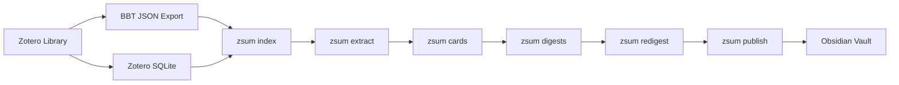

# Zotero Summarizer

**Generate AI-powered summaries of your Zotero library collections as an Obsidian vault.**

---

For each paper in your library, `zsum` extracts PDF text and produces a structured LLM summary covering the research problem, methods, key findings, limitations, and keywords. For each collection, it synthesizes a digest from its paper cards. Everything is published as an interlinked [Obsidian](https://obsidian.md) vault with wikilinks between papers and collections.

## Key Features

<div class="grid cards" markdown>

-   **Structured Paper Summaries**

    ---

    Each paper gets a structured JSON summary with problem statement, methods, key findings, limitations, and keywords — generated by any supported LLM.

-   **Collection Digests**

    ---

    Collections are synthesized into thematic digests that cite individual papers, processed bottom-up so parent collections can reference child summaries.

-   **Obsidian Integration**

    ---

    Output is an Obsidian vault with wikilinks, frontmatter metadata, and a navigable index. An optional Obsidian plugin provides a full graphical interface.

-   **Multi-Provider LLM Support**

    ---

    Use Claude (via Claude Code CLI), local models (LM Studio, Ollama, vLLM), Codex CLI, or Gemini CLI. Route different stages to different providers.

-   **Incremental Caching**

    ---

    Cards and digests are cached. Only new or changed papers are processed on subsequent runs, saving time and LLM costs.

-   **Citation Counts**

    ---

    Fetch citation counts from OpenAlex and Semantic Scholar. Counts appear in paper notes, collection digests, and the plugin UI.

</div>

## How It Works



The pipeline reads your Zotero data, extracts text from PDFs, generates LLM summaries, and writes an Obsidian vault. Each stage can be run independently or all at once with `zsum all`.

## Quick Start

```bash
# Install
git clone https://github.com/CEmM2/zotero-summarizer.git
cd zotero-summarizer
uv sync
uv tool install -e .  # makes `zsum` available globally

# Configure
cp config.example.yaml config.yaml
# Edit config.yaml with your paths and LLM provider

# Preview (no LLM cost)
zsum skeleton

# Generate everything
zsum all
```

See the [Installation Guide](getting-started/installation.md) for detailed setup instructions.

## Output Structure

The generated vault looks like this:

```
vault/
├── Library Index.md          # Map of all collections with stats
├── Collections/
│   ├── Phase Field.md        # Collection note with digest + paper links
│   └── Fracture.md
└── Papers/
    ├── smith2017.md           # Paper note with structured summary
    └── zhao2020.md
```

Notes use Obsidian wikilinks (`[[...]]`) for navigation between papers and collections.

## Requirements

- **Python 3.11+** with [uv](https://docs.astral.sh/uv/)
- **Zotero** with [Better BibTeX](https://retorque.re/zotero-better-bibtex/)
- One LLM backend (cloud or local)

## What's Next

- [Installation Guide](getting-started/installation.md) — full setup walkthrough
- [Quick Start](getting-started/quickstart.md) — get running in 5 minutes
- [Pipeline Overview](guide/pipeline.md) — understand how the stages work
- [Obsidian Plugin](plugin/index.md) — graphical interface inside Obsidian
