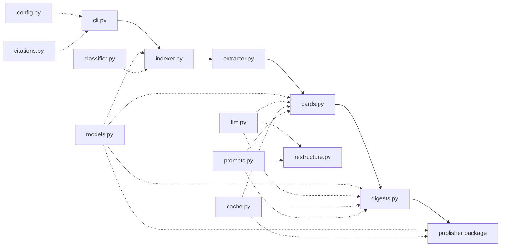

# Architecture

This page describes the internal architecture of `zsum` for contributors and advanced users.

## Module Overview

The pipeline flows linearly through these modules:



### Core Pipeline Modules

| Module | Purpose |
|---|---|
| `cli.py` | Click CLI entry point. Each pipeline stage is a subcommand; `all` runs them sequentially |
| `indexer.py` | Parses BBT JSON for items, queries Zotero SQLite for collections/hierarchy, builds `LibraryIndex` |
| `extractor.py` | PyMuPDF-based PDF text extraction with quality flagging |
| `cards.py` | Per-paper structured JSON summaries via LLM with strict validation |
| `digests.py` | Per-collection markdown digests, processed bottom-up. Includes redigest logic |
| `publisher/` | Writes Obsidian vault with frontmatter, wikilinks, and index |

### Support Modules

| Module | Purpose |
|---|---|
| `config.py` | Loads `config.yaml` into dataclasses. Holds paths, extraction params, LLM provider settings |
| `models.py` | Pydantic data models: `Item`, `Collection`, `LibraryIndex`, `PaperCard`, `CitationRecord`, etc. |
| `llm.py` | Provider-agnostic `complete()` dispatcher with retry logic |
| `cache.py` | Centralized cache I/O: card save/load, membership snapshots, hash-based invalidation |
| `prompts.py` | 3-tier prompt resolution: package data, CWD, built-in fallback |
| `classifier.py` | Heuristic paper-type detection (review/survey/meta-analysis/tutorial) |
| `citations.py` | OpenAlex/Semantic Scholar citation fetcher with caching |
| `restructure.py` | Collection hierarchy advisor (single LLM call, advisory-only) |
| `publisher/resolver.py` | Single source of truth for Obsidian-safe filenames and wikilink targets |

## Key Design Decisions

### Incremental Caching

Cards and digests are cached in `cache/`. The `prompt_version` config field invalidates all cached cards when prompts change. Digests invalidate on membership changes OR card content changes (SHA-256 hash comparison). See [Cache Layout](cache-layout.md) for details.

### Provider Abstraction

The LLM layer (`llm.py`) abstracts away provider differences. All four providers (Anthropic CLI, OpenAI-compatible, Codex CLI, Gemini CLI) expose a unified `complete()` interface. Switching providers requires only a config change.

Provider dispatch is stage-aware: the `routing` config lets different stages use different providers.

### Two-Phase Publishing

- **Phase A** (`skeleton`) builds the vault structure with metadata only (no LLM cost)
- **Phase B** (`all`) adds full summaries via LLM

### Strict Card Validation

Card parsing uses a 3-stage pipeline:

1. **Decode** — parse JSON response, strip markdown fences if present
2. **Validate** — reject non-dict payloads, dicts missing all expected fields
3. **Normalize** — source metadata from the local `Item` (never the LLM), normalize `paper_type`

### Bottom-Up Digest Processing

Collections are processed from leaves to root so parent digests can reference child summaries. The processing order is determined by the collection hierarchy depth.

### Advisory-Only Structure Analysis

`restructure.py` never writes back to Zotero, never mutates `LibraryIndex`, never reassigns papers. All output is purely advisory.

## Entry Point

The CLI entry point is `zsum.cli:main`, registered as `zsum` in `pyproject.toml`:

```toml
[project.scripts]
zsum = "zsum.cli:main"
```

## Source Layout

```
src/zsum/
├── __init__.py
├── cache.py
├── cards.py
├── citations.py
├── classifier.py
├── cli.py
├── config.py
├── digests.py
├── extractor.py
├── indexer.py
├── llm.py
├── models.py
├── prompts.py
├── prompts/
│   ├── paper_card.txt
│   ├── collection_digest.txt
│   ├── collection_digest_structured.txt
│   ├── collection_redigest.txt
│   └── restructure.txt
├── publisher/
│   ├── __init__.py
│   └── resolver.py
└── restructure.py
```

## LLM Client Lifecycle

`llm.py` caches clients at module level (`_openai_client`). This is safe for the CLI, which uses a single config per run.

If you reuse `zsum` as a library and switch configs between calls, call `_reset_clients()` between config changes.
